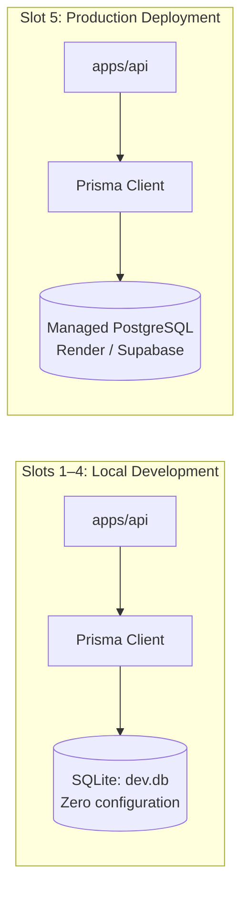

# Educational Architecture Specification — Course 4 Teaching Task Manager

> **System Name:** `course4-teaching-task-manager`  
> **Course:** Course 4 — The Modern AI Software Developer (ADLC01)  
> **Institution:** FPT University  
> **Standard:** Educational Engineering System — clean, strictly typed, modular, instructor-friendly.

---

## 1. System Overview & Monorepo Design

The teaching repository is organized as an **`npm workspaces` monorepo**, deliberately avoiding overly complex enterprise tooling (Turborepo, Nx, Lerna) to maintain maximum accessibility for undergraduate students while upholding enterprise design principles.

```text
course4-teaching-task-manager/
├── apps/
│   ├── api/                   # Express + TypeScript backend (REST API)
│   └── web/                   # React 18 + Vite + Tailwind CSS frontend
├── packages/
│   └── shared/                # Shared domain contracts, types & Zod schemas
├── prisma/                    # Schema, migrations & seed scripts (SQLite / PostgreSQL)
├── tests/
│   ├── unit/                  # Fast Vitest unit tests
│   ├── integration/           # Supertest API endpoint tests
│   ├── e2e/                   # Playwright browser end-to-end tests
│   └── bug-hunt/              # Seeded bug regression suite (Slot 4)
├── curriculum/                # Pedagogical blueprints (traceability, inventories, conflicts)
├── labs/                      # Student workbooks (Slot 1 to Slot 5)
├── instructor/                # Instructor run sheets, answer keys, recovery scripts
├── docs/                      # Architectural specs, runbooks, security reports
└── scripts/                   # Cross-platform automation scripts (.mjs)
```

---

## 2. Package & Dependency Boundaries

### 2.1. `packages/shared`
- **Purpose:** Single source of truth for domain schemas and type definitions, shared across frontend and backend.
- **Dependencies:** `zod`
- **Exports:**
  - `TaskSchema`, `CreateTaskSchema`, `UpdateTaskSchema`, `TaskQuerySchema`
  - Inferred TypeScript types: `Task`, `CreateTaskInput`, `UpdateTaskInput`, `TaskFilter`
  - Enums / Constants: `TaskStatus` (`TODO`, `IN_PROGRESS`, `DONE`), `TaskPriority` (`LOW`, `MEDIUM`, `HIGH`)
  - Standard API envelopes: `ApiResponse<T>`, `ApiErrorResponse`

### 2.2. `apps/api`
- **Purpose:** Headless HTTP API serving JSON resources.
- **Runtime:** Node.js (LTS >= 20.x) + Express + TypeScript
- **Dependencies:**
  - `express`, `cors`, `dotenv`, `pino`, `pino-http` (production logging)
  - `@prisma/client`
  - Internal workspace dependency: `packages/shared`
- **Dev Dependencies:**
  - `tsx` (fast TS execution), `typescript`, `vitest`, `supertest`, `@types/express`, `@types/supertest`
- **Key Modules:**
  - `src/routes/tasks.ts`: CRUD endpoints with Zod middleware validation.
  - `src/routes/health.ts`: Observability endpoint returning system status and DB latency.
  - `src/middleware/auth.ts`: Educational authentication middleware parsing `X-User-Id` (or Bearer token).
  - `src/middleware/logger.ts`: Pino structured JSON request/response logging.
  - `src/middleware/errorHandler.ts`: Sanitized error responses preventing internal stack leakages.

### 2.3. `apps/web`
- **Purpose:** Interactive Single-Page Application (SPA).
- **Runtime:** Browser (Vite dev server & optimized static build)
- **Dependencies:**
  - `react`, `react-dom`, `lucide-react` (clean icons)
  - Internal workspace dependency: `packages/shared`
- **Dev Dependencies:**
  - `vite`, `@vitejs/plugin-react`, `tailwindcss`, `postcss`, `autoprefixer`, `typescript`
- **Key Components:**
  - `TaskList`: Displays task cards with priority badges and completion checkboxes.
  - `TaskFilterBar`: Accessible filter tabs (All, Active, Completed) with keyboard navigation.
  - `TaskFormModal`: Create/edit modal powered by Zod schema validation.
  - `api/client.ts`: Typed fetch wrapper communicating with `apps/api`.

---

## 3. Database & Persistence Layer Evolution

A core pedagogical challenge in software education is the friction of database installation versus the realism of cloud deployments. We solve this by leveraging **Prisma ORM** across two distinct phases:



### 3.1. Phase 1: Local Teaching Checkpoints (Slots 1–4)
- **Database Engine:** **SQLite** (`file:./prisma/dev.db`).
- **Rationale:** Requires zero local daemon installation (no Docker, no PostgreSQL server install required on student PCs). Completely cross-platform on Windows, macOS, and Linux.
- **Reproducibility:** Seeded automatically via `npm run db:seed` with standard fixtures (`Write PRD draft`, `Set up repo`, `Review PR #3`).
- **Reset:** `npm run db:reset` recreates the SQLite database from scratch in < 1 second.

### 3.2. Phase 2: Production Cloud Deployment (Slot 5)
- **Database Engine:** **PostgreSQL** (hosted on Render or Supabase free tier).
- **Migration Path:**
  - Prisma schema is written using generic types (`String`, `Boolean`, `DateTime`, `Int`).
  - A small switch utility (`scripts/switch-db.mjs`) updates the provider in `prisma/schema.prisma` from `sqlite` to `postgresql`.
  - Deployment pipeline runs `npx prisma migrate deploy` followed by production seeding.
  - Demonstrates twelve-factor application configuration: `DATABASE_URL` injected via environment variable.

---

## 4. Cross-Cutting Engineering Concerns

### 4.1. Validation Architecture
- In traditional apps, validation is duplicated or out of sync between client and server.
- In this repository, `packages/shared` defines Zod schemas. Both `apps/api` (via Express validation middleware) and `apps/web` (via form submission handlers) consume the identical schema.

### 4.2. Observability & Logging Architecture
- Development: Human-friendly pretty-printed console output.
- Production: Structured JSON output via `pino` including:
  ```json
  {"level":30,"time":1700000000000,"reqId":"req-1a2b","method":"GET","url":"/api/tasks","status":200,"responseTimeMs":12}
  ```
- This directly prepares students for Slot 5 Slide 10 ("Know Whether Your System Is Healthy") and the Incident Drill.

### 4.3. Security Architecture
- **Authentication:** Simulated multi-user context using `X-User-Id` header (Users 1, 2, 3), allowing easy testing of multi-tenant authorization.
- **Authorization:** Strict ownership check (`task.userId === req.userId`) enforced at the service level, illustrating the fix for OWASP A01 (Broken Object Level Authorization / IDOR).
- **Static Analysis:** Semgrep ruleset checking for SQL injection, dangerous regexes, and missing authorization checks.
